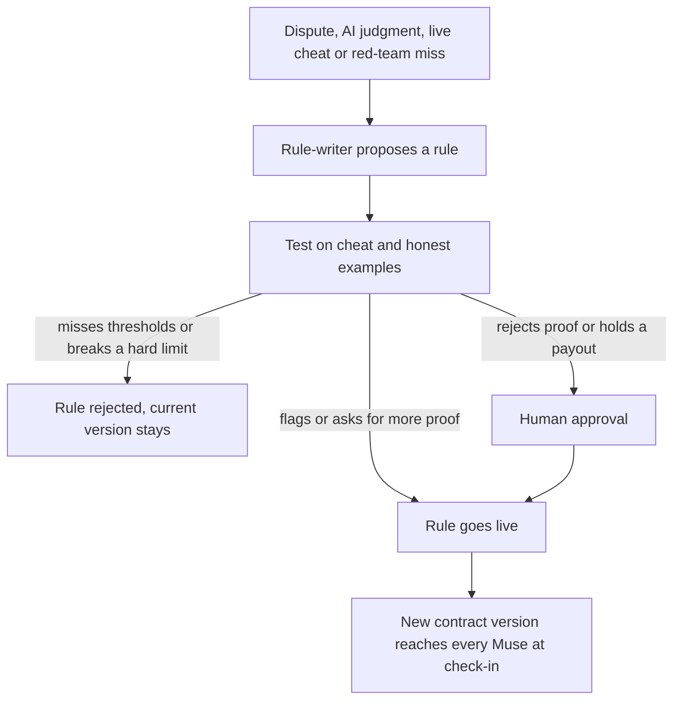

# Lane MVP - Plan

## Goal Capsule

- **Objective:** By 5 PM PDT on 2026-10-11, hackathon judges watch people join a Lane challenge through their own Meta Muse and watch Lane's referee agents catch a junk proof and learn a new anti-cheat rule live, on a deployed system that answers the hackathon's Statement One, Recursive Harnessing.
- **Product authority:** Max and Antoine, the Lane team. The hackathon rules live in HQ at `companies/lane/knowledge/market/hackathon-requirements.md`, outside this repo.
- **Open blockers:** None block planning. Two first-hour tests gate the demo surface and are listed under Dependencies / Assumptions.

---

## Product Contract

### Summary

Lane is an agentic accountability service that people use through their own AI agent, Meta Muse.
A person creates or joins a challenge by telling their Muse and stakes play credits into the challenge's pot.
Their Muse sends proof of progress, Lane's referee agents verify it and learn new anti-cheat rules as they go, and the pot goes to the winner.
The MVP ships three separate challenges: Ship Week, Talk to Customers and Build in Public.

### Problem Frame

Commitment contracts work: people with money at stake follow through on goals more often than people offered a reward.
They break down on proof.
Today's products rely on screenshots, self-reports and human referees, and people cheat with junk commits, calls with friends, filler posts and edited screenshots.
People now have personal agents with access to their GitHub, calendar, email and social accounts, but there is no service those agents can register with, report to and be held accountable by.

### Actors

- A1. Challenge creator: the person who starts a challenge by telling their Muse.
- A2. Player: anyone in a challenge, including the creator.
- A3. Player's agent: the player's Muse, or a scripted agent standing in for a player in the demo.
- A4. Lane orchestrator: Lane's agent that owns each challenge's contract, the player inboxes, scoring and settlement.
- A5. Lane referees: Lane's agents that verify proof and improve the rules, namely the verifier with its AI reviewer, the red team, the rule-writer and the promoter.
- A6. Human approver: a person who approves proof-rejecting rules and large payouts on the dashboard.
- A7. Judges: hackathon judges watching the dashboard and the live demo.

### Key Decisions

- **Three separate challenges, each with its own players, pot and winner.** (session-settled: user-directed — chosen over one combined Founder Week challenge: each challenge stands alone and the strongest one is demoed.) Governs R1, R2, R3, R24.
- **The demo persona is Maya, a founder, with friends Gary, Priya and Sam, who plays the cheater.** (session-settled: user-directed — chosen over fitness and job-seeker personas: the judges are founders and builders.) Governs R30.
- **People register only through their own Muse.** (session-settled: user-directed — chosen over invite links: Lane is agent-first.) Governs R5.
- **Muse fetches all proof and Lane's verifier checks it.** (session-settled: user-directed — chosen over Lane pulling data from sources itself: the person's agent collects and Lane verifies.) Governs R13, R14, R15, R16.
- **The orchestrator owns each challenge's contract.** (session-settled: user-directed — chosen over rules fixed in code: the contract sets the boundaries Muse works within and changes as rules are learned.) Governs R8, R9.
- **Lane reaches players only through an inbox that Muse polls on a routine.** (session-settled: user-directed — chosen over pinging Muse on demand, which Muse does not support: a fixed routine is reliable, and an odd interval feels unscheduled.) Governs R10, R11, R12.
- **Referees learn from four sources, and on stage the AI reviewer catches a junk commit by itself.** (session-settled: user-directed — chosen over a single learning source.) Governs R20.
- **Every challenge gets the full learning loop, built in parallel, and the best one is demoed.** (session-settled: user-directed — chosen over a deep loop on commits only.) Governs R24.
- **The creator picks the winner rule.** (session-settled: user-directed — chosen over a fixed rule.) Governs R6.
- **Play credits only.** (session-settled: user-approved — chosen over real money: Stripe prohibits paid-entry prize contests and real-money peer betting needs legal review.) Governs R7.
- **Bets on people, deposits, the Hail Mary and the coach move to the roadmap.** (session-settled: user-directed — chosen over including them today: the MVP shows one easy scenario.)
- **Muse is the only consumer agent today.** (session-settled: user-directed — chosen over Instinct and general assistants: the team has Muse and the demo needs one working surface.)

### Requirements

**Challenge types**

- R1. Ship Week counts a meaningful commit on the player's own project on each day of the window.
- R2. Talk to Customers counts real conversations with customers or prospects during the window.
- R3. Build in Public counts a real build-log post on X, Instagram or LinkedIn on each day of the window.

**Creation and registration**

- R4. A creator starts a challenge by describing it to their Muse in one sentence, and the orchestrator turns it into a contract, asking clarifying questions back through Muse when the sentence is ambiguous.
- R5. Other people join only by telling their own Muse which challenge to join, which registers them, takes their stake into the pot and delivers the contract.
- R6. The creator picks the winner rule at creation: the highest verified score takes the pot with ties split, or everyone who reaches the goal splits it.
- R7. Stakes and payouts are play credits, labelled as no real money.

**Contract and check-ins**

- R8. Each contract states what Muse must fetch and send, how proof is scored, what does not count, which extra proof Lane may ask for, the window and the check-in terms.
- R9. Contracts are versioned, and every player's Muse receives a new version at its next check-in.
- R10. At registration the player consents once to a Muse routine that checks in with Lane every 27 minutes and to up to 3 surprise proof checks a day, never between 10 PM and 8 AM in the player's time zone.
- R11. Everything Lane needs a player's agent to know or do waits in that player's inbox, and each check-in returns all of it in one response: requests for more proof, surprise checks, contract updates, standings and messages for the player.
- R12. A player can tell their Muse to check in or send proof at any time, which is also how the presenter runs the routine on stage.

**Proof and verification**

- R13. Each player's Muse fetches all proof from the player's own accounts and sends it to Lane, following the contract.
- R14. Lane's verifier checks that every proof is authentic, meaning real, the player's own and inside the window.
- R15. Lane's verifier checks that every proof has substance, meaning it counts toward the goal under the current contract.
- R16. The verifier re-checks public sources itself where they exist, such as public GitHub commits and public posts.
- R17. When the verifier is unsure, it asks for extra proof in its reply to the submission or through the inbox, such as a one-time code in a commit message or profile bio, meeting notes, the original invite email, or a fresh re-fetch of a post.
- R18. An unanswered surprise check holds that day's proof, and the day stops counting only if the check is still unanswered after a grace period.
- R19. Every rejected proof carries the rule it broke and how to fix it.

**Self-improving anti-cheat**

- R20. Referees learn new rules from four sources: a player disputing another player's proof, the AI reviewer turning its own judgments into rules that run without an AI call, a live cheater, and a red-team agent that invents new cheats.
- R21. A new or tightened rule is tested before it goes live, against labelled cheat examples for catch rate and honest examples for false alarms, and is rejected if it misses the thresholds or breaks a hard limit set in Agent Engine's Policy Engine.
- R22. Rules that only flag a proof or ask for more proof go live automatically, and rules that reject a proof or hold a payout wait for human approval.
- R23. Every rule version keeps its parent version, reason, evidence and test results, and can be rolled back.
- R24. The full learning loop of R20 to R23 runs for all three challenge types.

**Asking Lane**

- R25. A player can ask Lane anything through their Muse at any time, including their standing, the leaderboard, the current rules and why a proof was rejected.
- R26. A player can dispute another player's proof through their Muse.

**Settlement**

- R27. When the window closes, the referees run a final check that re-fetches every post, and the orchestrator computes results under the challenge's winner rule.
- R28. The orchestrator pays out each pot in a single transaction, and any payout above a set limit waits for human approval first.

**Dashboard and demo support**

- R29. A judges' dashboard shows, per challenge, the players and scores, every proof with its verdict and reason, each rule version with its catch rate and false-alarm rate, and the approval queue.
- R30. Scripted player agents act through the same connector as Muse, including cheating.
- R31. Each challenge has seeded history so new rules can be tested against labelled examples.

### Key Flows

- F1. Create and register
  - **Trigger:** A creator tells their Muse to start a challenge.
  - **Actors:** A1, A2, A3, A4
  - **Steps:** Muse sends the sentence to Lane. The orchestrator writes the contract and asks any clarifying question. The creator confirms and picks the winner rule. Other players tell their own Muse to join. Each Muse registers, stakes, accepts the check-in terms, receives the contract and sets up its routine.
  - **Covered by:** R4, R5, R6, R7, R8, R10
- F2. Daily proof
  - **Trigger:** A player's Muse routine runs or the player asks Muse to send proof.
  - **Actors:** A3, A4, A5
  - **Steps:** Muse fetches what the contract asks for and submits it. The verifier checks authenticity and substance and re-checks public sources. The proof is accepted, rejected with a reason, or answered with a request for extra proof.
  - **Covered by:** R13, R14, R15, R16, R17, R19
- F3. Check-in
  - **Trigger:** The Muse routine runs or the player asks Muse to check Lane.
  - **Actors:** A2, A3, A4
  - **Steps:** Muse calls Lane, and Lane returns everything waiting in the player's inbox. Muse fetches any proof asked for, relays messages and standings to the player, and switches to any new contract version. A surprise check left unanswered holds that day.
  - **Covered by:** R9, R10, R11, R12, R17, R18
- F4. Learn a rule
  - **Trigger:** A dispute, an AI reviewer judgment, a live cheat, or a red-team miss.
  - **Actors:** A5, A6, A4
  - **Steps:** The rule-writer proposes a rule linked to its parent version. The rule is tested on cheat and honest examples. The promoter switches it on or sends it for human approval. The orchestrator issues a new contract version.
  - **Covered by:** R20, R21, R22, R23, R9

- F5. Ask and dispute
  - **Trigger:** A player asks their Muse something about the challenge.
  - **Actors:** A2, A3, A4, A5
  - **Steps:** Muse asks Lane. The orchestrator answers with standings, rules or the reason for a rejection. A dispute goes to the referees and becomes a learning source.
  - **Covered by:** R19, R20, R25, R26
- F6. Settlement
  - **Trigger:** The challenge window closes.
  - **Actors:** A4, A5, A6
  - **Steps:** Referees run the final check. The orchestrator computes results by the winner rule. Payouts above the limit wait for approval. The pot is paid in one transaction.
  - **Covered by:** R6, R27, R28

### Acceptance Examples

- AE1. **Covers R15, R20, R21, R22.** Given Ship Week is running, when Sam's agent submits a commit that only renames a variable, the AI reviewer rejects it and the rule-writer proposes "rename, whitespace or docs-only commits don't count". The rule passes its test, the presenter approves it on the dashboard because it rejects proof, and Sam's next rename-only commit is rejected without an AI call.
- AE2. **Covers R17, R20, R22, R26.** Given Talk to Customers is running, when Gary's agent submits a call whose only attendee has a personal Gmail address and Priya disputes it, the referees ask Gary for meeting notes and reject the call when none arrive. The rule-writer learns that such calls need meeting notes before they count, and that rule goes live automatically because it only asks for more proof.
- AE3. **Covers R15, R27.** Given Build in Public is running, when Sam posts one line of filler and later deletes a post that was already accepted, the filler is rejected for having no concrete detail and the deleted post stops counting at the final re-fetch.
- AE4. **Covers R18.** Given a surprise check asks Maya for a commit containing code 4821, when her Muse doesn't answer before the grace period ends, that day is held and then stops counting, and her other verified days are unaffected.
- AE5. **Covers R21.** When the rule-writer proposes a rule that wrongly flags more honest examples than the false-alarm threshold allows, the rule is rejected and the current version stays live.
- AE6. **Covers R6, R28.** Given the top-score winner rule, when Maya and Priya tie, they split the pot, and a share above the payout limit waits for human approval before it is paid.
- AE7. **Covers R4.** When Maya tells Muse "start Build in Public with my friends", the orchestrator asks which platforms count before creating the contract.
- AE8. **Covers R9, R11, R17.** Given Maya's last commit looked thin, when her Muse next checks in, the single response asks for a one-time code in her next commit message and also carries her standing and a new contract version, and her Muse acts on all three.

### Success Criteria

- The live moment works on stage: a junk commit is rejected, a rule is learned, tested, approved and switched on, and the next junk commit is caught without an AI call.
- The dashboard shows catch rate rising across rule versions while false alarms stay within the thresholds.
- All three challenges run end to end with scripted players, so the strongest one can be picked for the demo.
- At least one real person joins and submits real proof through their own Muse.
- The system runs deployed, not only on a laptop.

### Scope Boundaries

**Deferred for later** (detailed in `roadmap.md`)

- Bets for or against people on any condition, and live odds.
- Commitment deposits put on hold and lost on failure.
- The Hail Mary rescue.
- The coach agent, beyond the orchestrator reporting progress.
- Proof levels that rise when money rides against someone.
- Open challenges with strangers.
- More challenge types, such as weight loss, nutrition, 75 Hard-style rule sets, sleep, fitness, saving and learning.
- Other agents (Instinct, Claude, ChatGPT), directory listings and the Personal Agent Protocol.
- Real money.

**Outside this product's identity**

- A Lane app that people open and use directly. People use Lane through their own agent, and the dashboard is for spectators.

### Dependencies / Assumptions

- Muse can connect to Lane as a custom connector without Meta's review. Secondary sources say so, and it is a first-hour test.
- Muse can run a routine at the R10 interval that calls Lane. Meta documents custom intervals but no minimum, and it is a first-hour test.
- Lane cannot message Muse first. Meta documents only recurring tasks and reminders, which is why R11 exists.
- Muse can reach GitHub, Google Calendar, Docs, Gmail, Instagram and Threads. Its reach for X and LinkedIn posts is unconfirmed, and Threads is the fallback for R3.
- Meta's Gmail connector reportedly strips one-time codes from emails, so R17's codes go in commits and bios, never in email.
- Atlas Agent Engine is in public preview. Memory is shared across users when a service account invokes an agent, memory extraction is asynchronous, it needs at least a Flex cluster, and builds are capped at 100 a day.
- People, not agents, set up the accounts and keys: Atlas with Agent Engine access, an LLM API key, a Voyage key, the Vercel project and a logged-in Muse.

### Outstanding Questions

**Deferred to Planning**

- How rules are represented and run so that a learned rule needs no AI call.
- How scoring works within each challenge, such as several commits in one day or how many conversations meet the Talk to Customers goal.
- The R21 test thresholds. A starting proposal is at least 10 points more catch rate, at most 1% false alarms per rule and at most 2% overall.
- The grace period for R18 and the payout limit for R28.
- How the verifier treats proof from private sources it can't re-check, such as private repos, calendars and notes.
- How the dashboard updates live during the demo.

### Sources / Research

- HQ, outside this repo, `companies/lane/knowledge/market/hackathon-requirements.md`: requirements, problem statements and judges.
- HQ, outside this repo, `companies/lane/knowledge/market/lane-gamification-research.md`: commitment-contract evidence, anti-cheat methods, proof trust levels, Muse reach and Agent Engine facts.
- `roadmap.md`: everything deferred from this MVP.
- Atlas Agent Engine docs: https://www.mongodb.com/docs/agentengine/
- Agent Engine Policy Engine: https://www.mongodb.com/docs/agentengine/manage/governance/policy-engine/
- Agent Engine human-in-the-loop: https://www.mongodb.com/docs/agentengine/deploy/human-in-the-loop/
- Meta help center on Muse scheduled tasks: https://www.meta.com/help/artificial-intelligence/1484325780075655/
